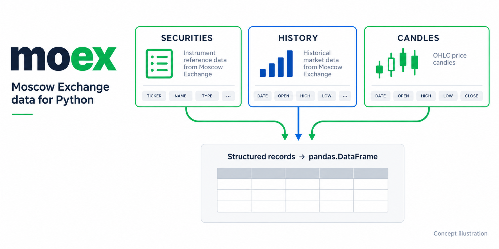

# moex



A Python client for Moscow Exchange ISS data. Search securities and retrieve market history, candles, index data and dividends
as structured records that can be converted into pandas tables.

## Install

```bash
pip install moex
```

## Quick start

```python
import moex
import pandas as pd
import requests

with requests.Session() as session:
    records = moex.find_securities(session, "SBER")
    securities = pd.DataFrame(records)

print(securities.head())
```

[Request helpers](moex/requests.py) · [ISS client](moex/client.py) ·
[MOEX ISS reference](https://iss.moex.com/iss/reference/)

<!-- okama-family:start -->
## Explore the okama family

Tools for investing and financial planning.

| Project | What it helps you do |
|---|---|
| [okama.io](https://okama.io/) | Explore portfolios with interactive web tools. |
| [okama](https://github.com/mbk-dev/okama) | Analyze investments and portfolios in Python. |
| [okama Data API](https://api.okama.io/) | Access historical market and economic data. |
| [okama-macro](https://github.com/mbk-dev/okama-macro) | Work with inflation and central-bank rate series. |
| [okama-mcp](https://mcp.okama.io/) | Use okama tools through an AI assistant. |
| [okama Planner](https://github.com/mbk-dev/okama-planner) | Build financial plans and manage client planning history. |

**[Join the okama community →](https://github.com/mbk-dev/okama/discussions)**

Ask questions, share examples and discuss financial planning.
<!-- okama-family:end -->
